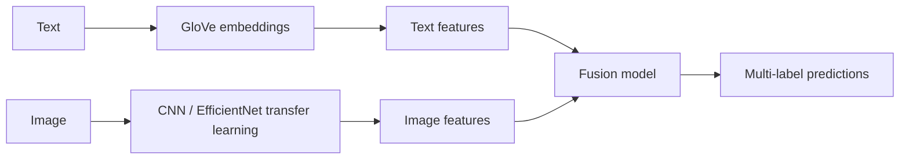

# Multimodal Text and Image Classification

Multi-label classification that fuses text and image signals: GloVe text embeddings and CNN image features are combined in a single Keras / TensorFlow model.

**Result:** mean average precision (MAP) of 70% on multi-label classification.

## Approach



1. **Text branch** (`notebooks/text_classification.ipynb`): preprocessing, GloVe embeddings and a text-only baseline.
2. **Image branch** (`notebooks/image_classification.ipynb`): transfer learning from EfficientNet, then image-only baseline.
3. **Fusion** (`notebooks/multimodal_fusion.ipynb`): the extracted features of both branches are concatenated and trained jointly; fusion variants are compared on AUC and accuracy.
4. **Exploration** (`notebooks/explore_multimodal.ipynb`): dataset analysis, label distribution, word clouds (`output/`).

## Repository layout

- `notebooks/`: the four notebooks above, with their outputs.
- `model/registry/`: extracted features (`.npy`) for train, validation and test splits, the text classifier and the image transfer model, so the fusion notebook runs without recomputing them.
- `data/image_classification/`: train, validation and test splits (CSV) used by the image branch.
- `output/`: figures produced by the exploration notebook.

## Run it

```bash
git clone https://github.com/lucgmensah/multimodal-text-image-classification.git
cd multimodal-text-image-classification
pip install tensorflow scikit-learn pandas numpy matplotlib wordcloud jupyter
jupyter notebook notebooks/multimodal_fusion.ipynb
```

## Stack

Python, TensorFlow / Keras, scikit-learn, GloVe, EfficientNet, NumPy, pandas.

---

Final project of the MSc Big Data & AI (BIHAR), ESTIA, 2024-2025. Previously part of `final_projet_lucg`. MIT licence.
